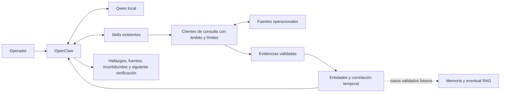

# Arquitectura objetivo propuesta

Diseño para el refactor; no describe capacidades ya desplegadas. Mantener OpenClaw y Qwen local como vía principal, Skills existentes y servicios de observabilidad externos. RAG y memoria de incidentes son posteriores al MVP.

## Responsabilidades

- OpenClaw controla entrada, selección de herramientas y ejecución; Qwen interpreta y redacta usando resultados comprobados.
- Los Skills explican cuándo consultar y cómo interpretar; los clientes validan argumentos, autentican, limitan solicitudes y normalizan errores.
- IXP Manager aporta miembros/ASN/puertos/VLAN; LibreNMS/Zabbix estado y sensores; PMACCT cambios BGP; Akvorado y tráfico disponible de IXP Manager vistas de tráfico; Graylog logs; Oxidized versiones de configuración. Validar capacidades reales antes de asumir campos.
- Conservar gNMI como fuente complementaria: un contador no es tasa y un UPDATE no es un cambio de prefijo identificado.
- El dominio asocia identificadores estables y ámbito. Correlación requiere entidades y ventanas compatibles; una coincidencia temporal no demuestra causalidad.

## Contrato propuesto de consulta

Cada resultado lleva `schema_version`, `query_id`, `source`, `scope` (IXP/POP/miembro cuando corresponda), filtros y ventana UTC, `collected_at`, `status`, `evidence`, `warnings`, errores tipificados y cobertura/paginación. Estados de consulta: `ok`, `partial`, `empty`, `error`. Un vacío no demuestra salud y `ok` solo significa consulta completada dentro de su cobertura.

Cada evidencia lleva entidad con identificadores originales, `observed_at` de la fuente cuando exista, `collected_at`, datos con unidades explícitas, `raw_reference` y advertencias. Si la fuente no proporciona hora de observación, conservar null y advertir; no sustituirla por la hora de colección. No guardar secretos ni URLs con credenciales como referencia. Mantener cardinalidad y cobertura para que límites o paginación incompleta no parezcan resultados completos.

Validar UTC, números finitos, unidades, origen y ámbito antes de correlacionar. Una fuente sin información suficiente de scope requiere mapeo autorizado o se rechaza para correlación entre ámbitos. Mantener separados datos originales, cálculos derivados, hipótesis y recomendaciones. El contexto contiene la consulta del caso; la memoria futura contiene investigaciones validadas con procedencia y control de acceso.

## Seguridad y operación

Permisos efectivos de lectura por fuente y ámbito, secretos externos, endpoints configurados por operador con allowlist, protección de redirecciones y SSRF, consultas parametrizadas y sin interpolación shell. Los resultados externos son datos no confiables. Una instrucción en un log nunca cambia los permisos o el plan del agente.

Definir presupuestos de tiempo, tamaño, filas, ventanas, reintentos y concurrencia por integración después de medir contratos reales. No reintentar autenticación fallida indiscriminadamente. Registrar solicitante, ámbito, query_id, fuente, duración, resultado y errores saneados. La indisponibilidad debe aparecer en la respuesta y en métricas operativas.

La ingesta BMP opera separada del agente de consulta: necesita escritura controlada, confirmación de entrega y política de recuperación. No habilitar cambios de configuración, reinicios o rutas desde el agente por defecto.

## Respuesta al operador

Presentar hallazgos observados con fuentes y horas; impacto comprobable; hipótesis con incertidumbre; fuentes faltantes o contradictorias; siguiente verificación sugerida. Explicar límites de cobertura y retrasos. No afirmar acciones ejecutadas a partir de recomendaciones, ni convertir ausencia de registros en ausencia de incidentes.
